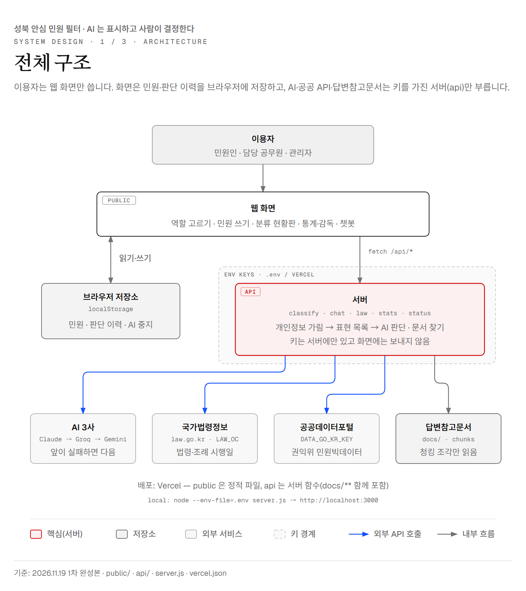
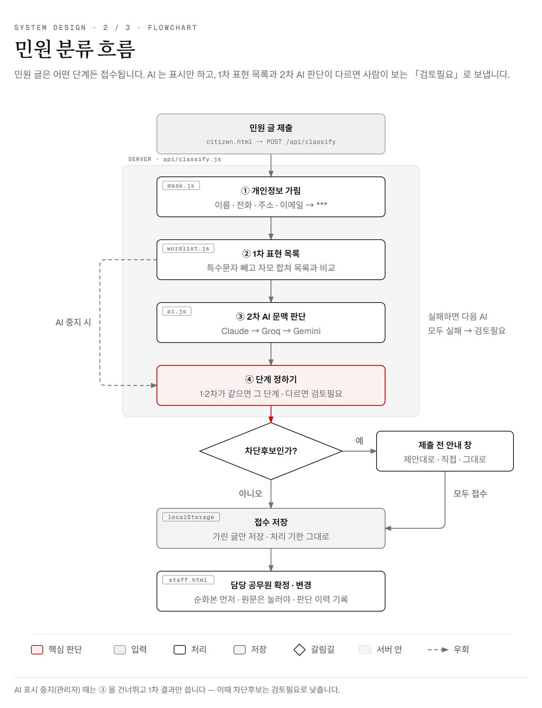
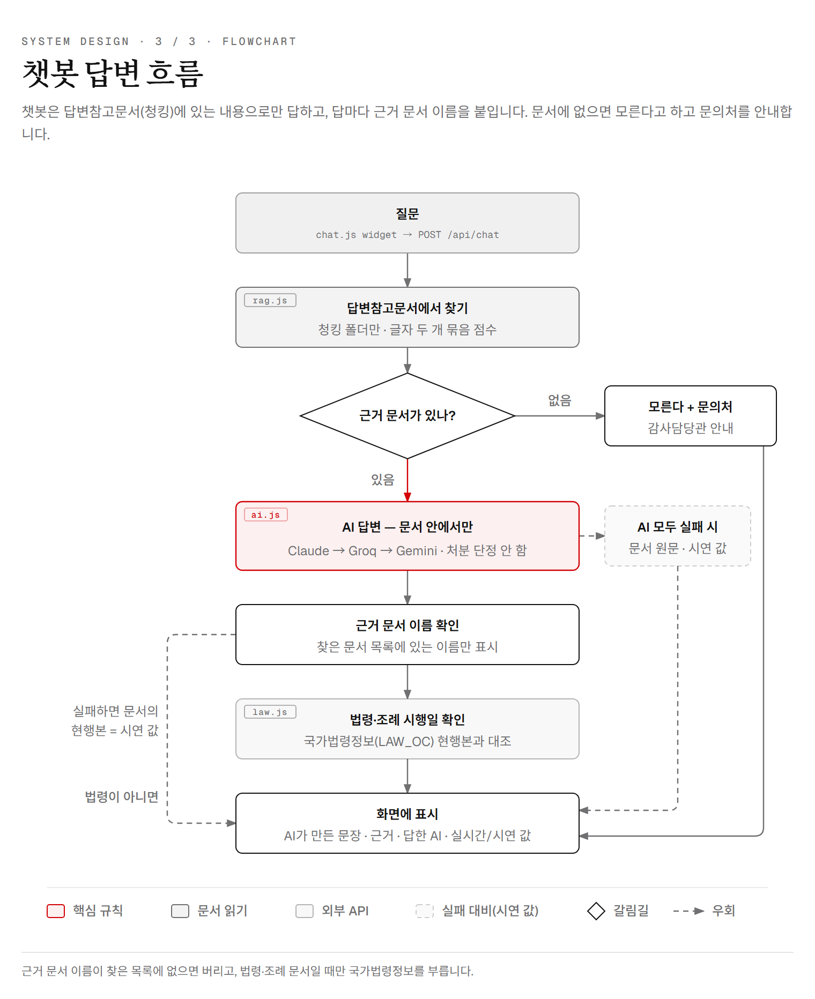

# 성북 안심 민원 필터

**AI 가 표시하고, 사람이 결정하는 온라인 민원 글 보호·순화 서비스 (시제품)**

성북구청 「구청장에게 바란다」로 들어오는 글 민원에서 욕설·모욕·협박·성희롱 표현을 AI 가 **표시만** 합니다. 담당 공무원은 문제 표현을 원문 그대로 읽지 않고도 민원을 처리할 수 있고, 민원인은 제출 전에 표현을 고칠 기회를 받습니다. 어떤 경우에도 민원은 접수되며, 단계를 정하는 것은 사람입니다.

> 한성대학교 「AI 기반 공공행정 캡스톤」 2026-2 · 성북구 제안 「AI 활용 공공행정 서비스 혁신」 아이디어 ③
> 시제품은 실제 민원 대신 **[가상 예시]** 민원만 씁니다.

---

## 누가 무엇을 하나

| 이용자 | 화면 | 하는 일 |
|---|---|---|
| 민원인 | 민원 쓰기 `citizen.html` | 글을 쓰고 제출 → 차단후보면 안내 창에서 「제안대로 고치기 · 직접 고치기 · 그대로 제출」 중 선택(어느 쪽이든 접수) · 내 민원 확인 · 7일 소명 |
| 담당 공무원 | 분류 현황판 `staff.html` | 정상 · 검토필요 · 차단후보 탭 · 순화본과 요약 먼저 보기 · [원문 보기] · 단계 확정 · 변경(선택형 사유) · 판단 이력 |
| 부서 관리자 · 감사 담당 | 통계·감독 `admin.html` | 단계별 건수 · 판단 변경률 · 오분류 사례 · 이력 조회 · **AI 표시 중지(수동 모드)** · 키·API 상태 |
| 모두 | 안내 챗봇(모든 화면 오른쪽 아래) | 서비스에 대해 묻기 — 답변참고문서로만 답하고 근거 문서 이름을 붙임 |

## 3단계 분류

| 단계 | 기준 | 민원인에게 | 공무원에게 |
|---|---|---|---|
| 정상 | 욕설·모욕·협박·성희롱 없음. **강한 비판도 정상** | 접수 완료 | 일반 접수함 |
| 검토필요 | 비꼬기·돌려 말한 비하, 또는 1차·2차 판단이 서로 다름 | 접수 완료(내부 단계는 안 보임) | 노란 표시 · 순화본 + 요약 · AI 이유와 정상 가능성 근거 |
| 차단후보 | 욕설·모욕·협박·성희롱이 뚜렷함 | 제출 전 안내 창(3가지 선택) | 빨간 표시 · 문제 표현 ○○ 가림 · [원문 보기] |

「차단」은 접수 거부나 삭제가 아니라, 공무원 화면에서 문제 표현을 가린 채 두는 것입니다.

---

## 시스템 설계도

전체 3쪽 PDF: [`docs/시스템설계도.pdf`](docs/시스템설계도.pdf) · 원본 HTML: [`docs/시스템설계도.html`](docs/시스템설계도.html)

### 1. 전체 구조



### 2. 민원 분류 흐름



### 3. 챗봇 답변 흐름



---

## 지키는 원칙

- **AI 는 표시·제안만** 합니다. 단계 확정·변경은 담당 공무원만 합니다.
- **자동 종료 · 접수 거부 · 민원 삭제 · 민원인 목록화 · 자동 제재를 하지 않습니다.**
- 이름·전화번호·주소는 **AI 에 보내기 전에** `***` 로 가립니다.
- 1차(표현 목록)와 2차(AI) 판단이 다르면 AI 가 고르지 않고 **검토필요**로 보냅니다.
- 순화본·제안 문장·요약·챗봇 답에는 **「AI가 만든 문장」** 을 표시합니다(인공지능기본법 제31조).
- 챗봇은 `docs/답변참고문서/청킹` 의 내용으로만 답하고, 없으면 모른다고 한 뒤 문의처를 안내합니다.
- AI · 공공 API 결과에는 **「실시간 / 시연 값」** 을 구분해 보여 줍니다. 실패하면 이유(키 비어 있음 · 승인 안 됨 · 시간 초과)를 함께 보여 줍니다.

## 기술 구성

| 부분 | 내용 |
|---|---|
| 화면 | `public/` — HTML · CSS · JavaScript(프레임워크 없음), 디자인은 흑백 기반 알약 버튼 |
| 서버 | `api/` — Vercel 서버 함수(Node.js). 로컬은 `server.js` |
| AI | Claude → Groq → Gemini 순서. 앞이 실패하면 다음으로 넘어가고, 모델 이름은 키로 모델 목록을 조회해 고름 |
| 공공 API | 국가법령정보 공동활용(법령·조례 현행 시행일) · 공공데이터포털 국민권익위원회 민원빅데이터(참고 통계) |
| 근거 문서 | `docs/답변참고문서/청킹` — 법령·조례·정부 자료를 조각으로 나눈 것 |
| 저장 | 서버 저장소(Upstash Redis · Vercel KV)가 연결되면 서버에 저장 — 민원 · 판단 이력(서버가 기록) · AI 중지 설정. 연결 전에는 브라우저 `localStorage` 로 동작 |
| 접근 제한 | `STAFF_PASSWORD` · `ADMIN_PASSWORD` 를 넣으면 담당자·관리자 화면에 로그인이 생김(비우면 시연 모드). AI 호출 API 는 IP 당 횟수 제한 |

## 직접 실행하기

1. Node.js 20 이상을 설치합니다.
2. 프로젝트 맨 위에 `.env` 파일을 만들고 아래 이름으로 키를 넣습니다. **`.env` 는 깃허브에 올리지 않습니다.**

   | 이름 | 넣을 값 |
   |---|---|
   | `CLAUDE_API_KEY` | Anthropic Claude 키 |
   | `GROQ_API_KEY` | Groq 키 |
   | `GEMINI_API_KEY` | Google Gemini 키 |
   | `LAW_OC` | open.law.go.kr 신청 때 등록한 OC(이메일 @ 앞부분) |
   | `DATA_GO_KR_KEY` | 공공데이터포털 일반 인증키(Encoding · Decoding 아무거나) |

   키가 비어 있으면 그 기능은 이유와 함께 「시연 값」으로 동작합니다. 전체 이름 목록(로그인 비밀번호 · 서버 저장소 포함)은 [`.env.example`](.env.example) 에 있습니다.

3. 실행합니다.

   ```bash
   npm install
   npm start
   ```

4. 브라우저에서 <http://localhost:3000> 을 엽니다.

배포는 Vercel 에 이 저장소를 연결하고, Environment Variables 에 위 이름 그대로 키를 넣으면 됩니다(`vercel.json` 이 `docs/**` 를 서버 함수에 함께 넣습니다).

## 폴더 구조

```
public/                 이용자가 보는 화면 (index · citizen · staff · admin + css · js)
api/                    서버: classify · chat · law · stats · status · auth(로그인) · db(민원 저장소)
api/_lib/               개인정보 가림 · 표현 목록 · AI 호출 · 문서 찾기 · 공공 API
docs/답변참고문서/       원본 → 청킹전 → 청킹(서버는 청킹만 읽음)
docs/시스템설계도.*      시스템 설계도 (PDF · HTML · PNG)
server.js               로컬 실행용 서버
vercel.json             배포 설정
```

## 시제품의 한계

- 서버 저장소(`KV_REST_API_URL` · `KV_REST_API_TOKEN`)를 연결하지 않으면 데이터가 **브라우저에만** 저장되어 기기마다 따로이고, 판단 이력도 고칠 수 있습니다. 연결하면 서버가 이력을 남깁니다.
- 로그인은 비밀번호 하나짜리 시제품 방식입니다. 실제 도입 때는 공무원 인증(SSO)으로 바꿔야 합니다.
- 1차 표현 목록은 시연용 작은 목록입니다(기획서의 약 1,200개 목록은 아직 없음). 실제 적용 전 구청 담당 부서의 검토가 필요합니다.
- 공공데이터포털 민원빅데이터는 활용 신청이 승인되기 전까지 「시연 값」으로 보입니다.
- 로그인이 없어 누구나 공무원·관리자 화면을 열 수 있습니다(시연용).

## 문의

성북구청 감사담당관 02-2241-4901/2185 · 대표전화 02-2241-3114
